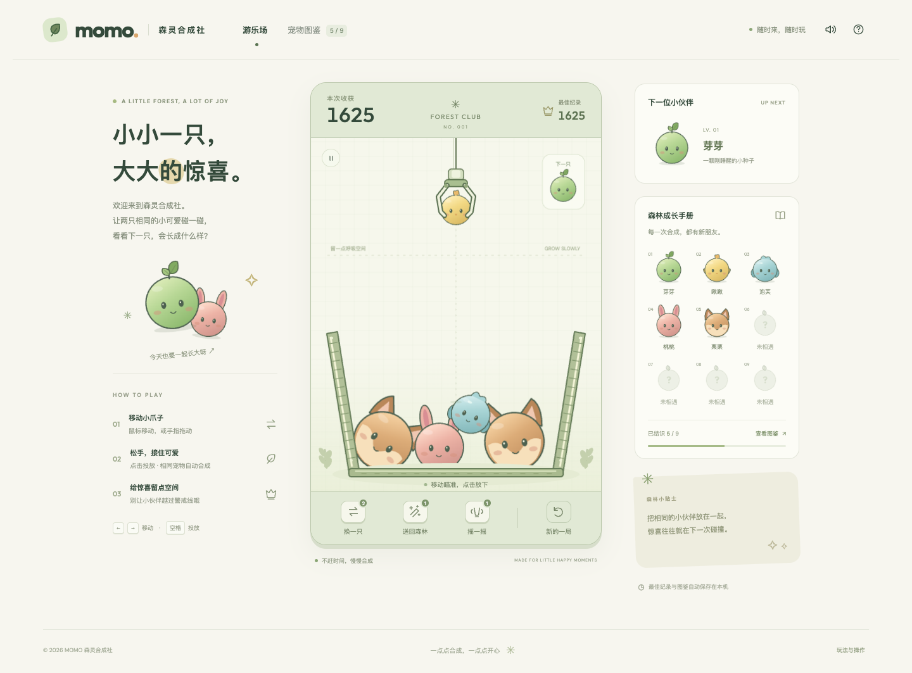

https://jdb156158.github.io/PetCaptureAndSynthesis/

[](https://jdb156158.github.io/PetCaptureAndSynthesis/)

# MOMO · 森灵合成社

A cozy, browser-based pet merging game. Move the claw, drop a forest spirit, and merge matching companions into the Forest Guardian. All nine pets are original procedural illustrations.

根据参考视频里的「机械爪投放 → 物理堆叠 → 同级碰撞合成」玩法制作的网页游戏。9 种原创森林宠物，以芽芽为起点，一路合成为森灵王。宠物和场景均为代码绘制，未使用视频中的角色素材。

## Play / 操作

- Desktop: move the mouse and click to drop; or use `←` / `→` and `Space`. Press `P` to pause.
- Mobile: drag inside the playfield to aim, then release to drop.
- Matching pets merge automatically. Chain merges earn bonus points. Keeping pets above the limit for 3 seconds ends the round; creating the ninth pet wins.
- Swap the held and next pet, send a selected pet home, or shake the basket. Tool charges reset each round.
- Best score, discovered pets, and sound preference are saved locally in the browser.

电脑：移动鼠标瞄准，点击投放；也可使用方向键和空格。手机：手指拖动瞄准，松手投放。相同等级自动合成，连续合成额外加分。宠物持续越过警戒线 3 秒则结束本局，合成第 9 级宠物即可通关。道具每局重置，最佳纪录与图鉴保存在当前浏览器。

## Run locally / 本地运行

No build or package installation is required. Fonts, physics, and artwork are served locally.

```sh
python3 -m http.server 4187 --directory dist
```

Open [http://localhost:4187](http://localhost:4187).

```sh
node --test tests/game.test.cjs
```

## Implementation / 实现

- HTML / CSS / Canvas 2D; Matter.js 0.20.0 for rigid-body physics, vendored with its MIT license.
- Original pets in `dist/pets.js`; simulation rules in `dist/core.js`; rendering, input, and UI in `dist/app.js`.
- Local DM Sans and Outfit fonts under the SIL Open Font License; license files accompany the fonts.
- GitHub Actions checks the game and deploys `dist/` to GitHub Pages.

See [verification notes](docs/verification.md) and the [mobile screenshot](docs/mobile.png). Local saves are browser-specific; no account or server is involved.
